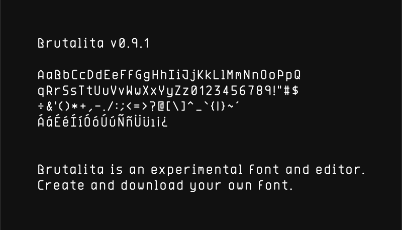

# Brutalita

[](https://brutalita.com/)

Brutalita is an experimental font and font editor. Draw in your browser, download OTF.

The name means "little brutal" in spanish.

- **[brutalita.com](https://brutalita.com/)** — the editor
- **[brutalita.com/demo](https://brutalita.com/demo)** — specimens at several sizes

## Download

Two families, **Brutalita** (proportional) and **Brutalita Mono**, each in nine
weights, as OTF for desktop and WOFF2 for the web. These links always point at
the latest release.

| Weight | Desktop | Web |
| --- | --- | --- |
| Thin | [Brutalita-Thin.otf](https://brutalita.com/font/Brutalita-Thin.otf) | [Brutalita-Thin.woff2](https://brutalita.com/font/Brutalita-Thin.woff2) |
| Extra Light | [Brutalita-ExtraLight.otf](https://brutalita.com/font/Brutalita-ExtraLight.otf) | [Brutalita-ExtraLight.woff2](https://brutalita.com/font/Brutalita-ExtraLight.woff2) |
| Light | [Brutalita-Light.otf](https://brutalita.com/font/Brutalita-Light.otf) | [Brutalita-Light.woff2](https://brutalita.com/font/Brutalita-Light.woff2) |
| Regular | [Brutalita-Regular.otf](https://brutalita.com/font/Brutalita-Regular.otf) | [Brutalita-Regular.woff2](https://brutalita.com/font/Brutalita-Regular.woff2) |
| Medium | [Brutalita-Medium.otf](https://brutalita.com/font/Brutalita-Medium.otf) | [Brutalita-Medium.woff2](https://brutalita.com/font/Brutalita-Medium.woff2) |
| Semi Bold | [Brutalita-SemiBold.otf](https://brutalita.com/font/Brutalita-SemiBold.otf) | [Brutalita-SemiBold.woff2](https://brutalita.com/font/Brutalita-SemiBold.woff2) |
| Bold | [Brutalita-Bold.otf](https://brutalita.com/font/Brutalita-Bold.otf) | [Brutalita-Bold.woff2](https://brutalita.com/font/Brutalita-Bold.woff2) |
| Extra Bold | [Brutalita-ExtraBold.otf](https://brutalita.com/font/Brutalita-ExtraBold.otf) | [Brutalita-ExtraBold.woff2](https://brutalita.com/font/Brutalita-ExtraBold.woff2) |
| Black | [Brutalita-Black.otf](https://brutalita.com/font/Brutalita-Black.otf) | [Brutalita-Black.woff2](https://brutalita.com/font/Brutalita-Black.woff2) |

Mono files are named `Brutalita Mono-{Style}`, with the space URL-encoded:
[Mono Regular OTF](https://brutalita.com/font/Brutalita%20Mono-Regular.otf),
[WOFF2](https://brutalita.com/font/Brutalita%20Mono-Regular.woff2).

```css
@font-face {
  font-family: 'Brutalita';
  src: url('https://brutalita.com/font/Brutalita-Regular.woff2') format('woff2');
  font-weight: 400;
}
```

Both families cover printable ASCII, the Spanish set — `ÁÉÍÑÓÚÜ áéíñóúü ¿ ¡` —
and `↕`. Accents sit in their own band above the cap line, so a line of accented
capitals still fits its line box; `line-height: normal` is 1.25em.

## CLI

Compile a font source to `.otf` without opening the editor.

```sh
pnpm dlx brutalita build my-font.json -o MyFont.otf
```

The source is the same JSON the editor exports — `{ "config": {...}, "marks": {...},
"chars": {...} }` — where each glyph is a list of polylines on a 2×4 half-step grid.
With no source argument the CLI looks for `./font.json`, then `./src/font.json`, then
falls back to the copy of Brutalita it bundles.

**Stroke** in the Style tab is the pen, saved as `config.stroke`: `round` (the
default) rounds every end, corner and dot by half the stroke; `sharp` cuts ends
flat, brings corners to a point and makes dots square.

The glyphs draw their curves as chamfers. **Curves** in the Style tab chooses
how those are rendered, saved as `config.corners`: `chamfer` (the default) keeps
them as drawn, `round` (Circular) turns each chamfer and shallow bend into an arc, and
`continuous` into a curve that eases in and out of its straights. Right angles
and points stay sharp, so "E" and "V" keep their corners while "O" turns round.
`config.cornerRadius` sets the size of the curves from `20` to `100` (the
default), as a percent of one grid step; at `100` an "O" is a pill. Both apply
to the editor previews, OTF builds, and SVG renders.

The editor's text preview is the font itself: each change rebuilds the OTF and
loads it into the page. The sidebar's **Style** tab holds weight, slant, stroke,
curves, width, and the spacing of the proportional family, saved in font units as
`config.spacing` (the gap between two flat-sided letters, default `480`),
`config.wordSpacing` (the width of the space, default one and a half letter
gaps) and `config.kerning` (the most a pair may be pulled together, default
`80`; `0` turns pair kerning off). All three move in steps of 80 units, one
pixel at 25.6px, so text set at that size or a multiple of it stays on the
pixel grid.

A glyph can also be built from another instead of drawn, either by taking an
accent from `marks` or by turning the letter around:

```json
"marks": { "acute": [[[0.5, 0], [1.5, -0.5]]] },
"chars": {
  "á": { "base": "a", "mark": "acute" },
  "¿": { "base": "?", "rotate": 180 }
}
```

### Commands

| Command | What it does |
| --- | --- |
| `build` | Compile a font source to `.otf` |
| `render` | Render text to a single-stroke `.svg` |
| `validate` | Check a font source for errors |
| `info` | Describe a font source, or read a built `.otf` back |
| `init` | Create a starter font source |
| `watch` | Rebuild whenever the source changes |

Run `brutalita help <command>` for the full option list.

```sh
# all nine standard weights, into a directory
brutalita build src/font.json -d public/font -w all

# any weight from 1 to 1000 builds, named after itself when it has no
# standard name (Brutalita-550.otf)
brutalita build src/font.json -w 550 --style-name SemiMedium

# pipe the bytes somewhere else
brutalita build src/font.json -w 700 -o - > Bold.otf

# a specimen image
brutalita render src/font.json -t "Hello\nWorld" --background "#111" --width 800 -o hello.svg

# check a font you are editing by hand
brutalita validate my-font.json --strict
brutalita info my-font.json
```

Diagnostics always go to stderr, so `--out -` and `--json` stay pipeable.
Exit codes: `0` success, `1` usage or I/O error, `2` invalid font source.

## Development

```sh
pnpm dev         # the editor at localhost:2788
pnpm cli         # run the CLI from source
pnpm assets      # regenerate every committed artifact (fonts + banner)
pnpm test        # unit tests + golden font/SVG regression tests
pnpm typecheck
pnpm build:cli   # bundle the CLI to dist/cli/brutalita.mjs
```

The `.otf` files are written by [`packages/otf-writer`](packages/otf-writer),
a dependency-free OpenType writer that imports nothing from the rest of the
repository.

The built fonts and the banner are committed: the `.otf` files are the golden
reference for the build tests, and GitHub serves the banner above straight from
the repo. `pnpm assets` rebuilds them byte-for-byte, so a clean `git status`
afterwards means they are current.

To release a new version of the typeface, bump `config.version` in `src/font.json`
and `RELEASED` in `scripts/build-fonts.ts`, then run `pnpm assets`.

## License

BSD 3-Clause. © Javier Bórquez.
